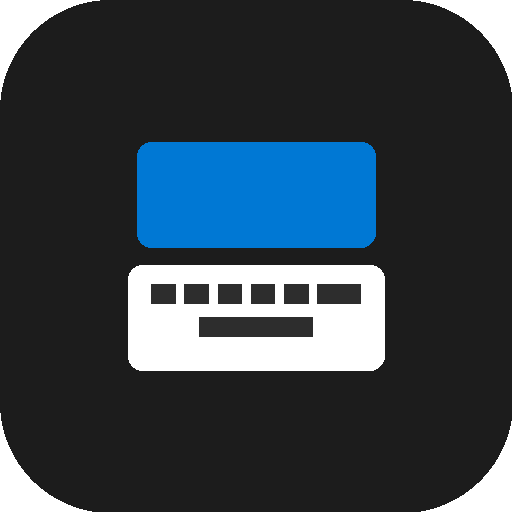
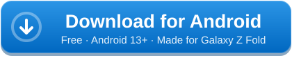
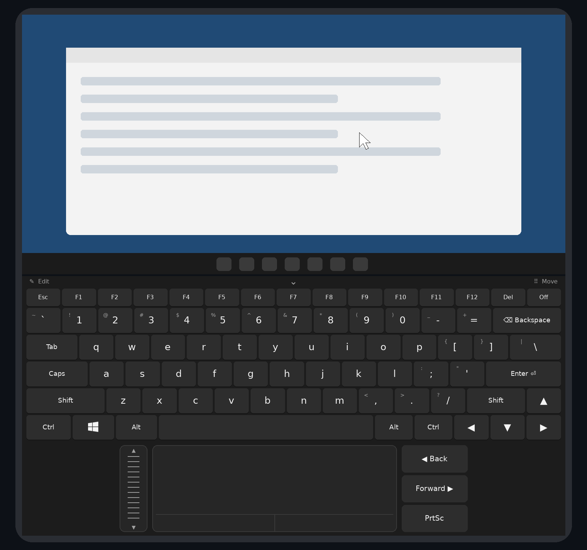
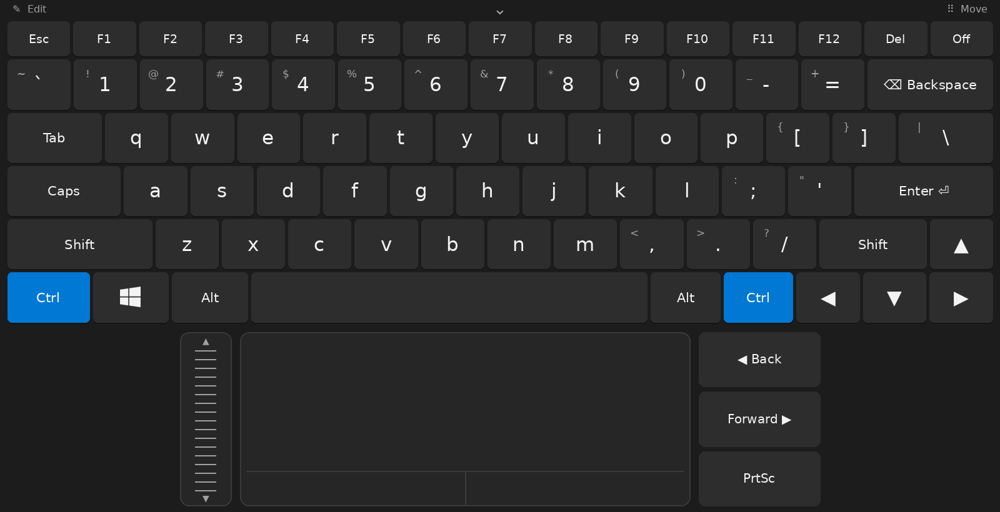
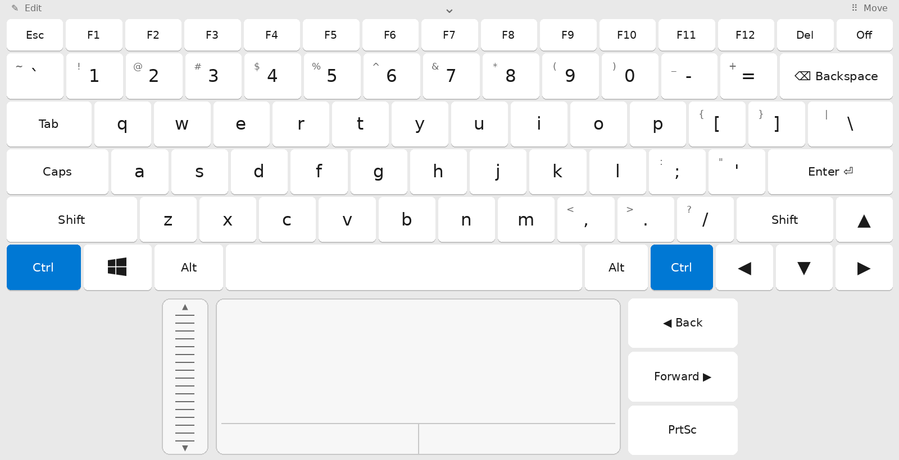

<p align="center">
  
</p>

<h1 align="center">LapFold</h1>

<p align="center">
  <b>Unfold it. Bend it. It's a laptop.</b><br>
  A Windows-style keyboard and trackpad for the bottom half of your Galaxy Z Fold. Works in any app, and Gboard stays your keyboard.
</p>

<p align="center">
  <a href="../../releases/latest"></a>
  <a href="../../releases/latest"></a>
  
  <a href="LICENSE"></a>
  <a href="../../stargazers"></a>
</p>

<p align="center">
  <a href="https://github.com/ilukezippo/LapFold/releases/download/v1.0.0/LapFold-v1.0.0.apk"></a>
</p>

<p align="center">
  <sub>Downloads the latest APK straight away. See <a href="#install">Install</a> for the two one-time steps Android asks for.</sub>
</p>

<p align="center">
  <a href="../../releases/latest">All downloads</a> ·
  <a href="#how-to-use">How to use</a> ·
  <a href="CHANGELOG.md">What's new</a> ·
  <a href="#install">Install</a> ·
  <a href="#build-from-source">Build</a>
</p>



<p align="center"><sub>If LapFold makes your Fold more useful, a ⭐ star on this page helps other people find it.</sub></p>

---

## Why

The Galaxy Z Fold already bends like a tiny laptop, but the bottom half is just more screen. LapFold turns it into a **real keyboard and trackpad** so you can type, click and scroll in any app — remote into your PC with Splashtop, write documents, answer email — without carrying a Bluetooth keyboard.

You don't have to switch keyboards: **Gboard stays your default**, and LapFold only takes over while it's on.

## How to use

| Do this | You get |
|---|---|
| Tap **Turn on** in the notification or the **LapFold** Quick Settings tile | Your current app moves to the top half, the keyboard and trackpad fill the bottom |
| Tap a text box in the top app, then type | Real key presses, including **Ctrl + C / V**, arrows and F-keys |
| Tap **Shift / Ctrl / Alt / Win** | Once = next key only, twice = locked, again = released |
| Move **one finger** on the trackpad | Moves the pointer; **tap** to click |
| **Two-finger tap** or the right button | Right-click (long press) |
| **Two-finger drag** or slide the **strip on the left** | Scroll, like a mouse wheel |
| Hold the **left button** and move | Drag |
| Tap **⌄** at the top of the keyboard | Slides the keyboard away; tap the **⌃** tab on the right edge to bring it back |
| Drag **⠿ Move** on the keyboard's top bar | Moves the keyboard anywhere; **✎ Edit → Dock** puts it back |
| Tap **✎ Edit** | Change the height and width of the keyboard, trackpad, scroll strip and buttons |
| **Back / Forward** next to the trackpad | Mouse back and forward buttons (Alt + ← / →) |
| **PrtSc** | Print Screen to the PC in Splashtop, or a phone screenshot otherwise |

Turn it off from the notification, the tile, or the **Off** key. Your app goes back to full screen.

**Splashtop:** switch Splashtop to its **trackpad mode**. LapFold notices Splashtop and drives Splashtop's own mouse pointer, so hover works: tap = click, two-finger tap = right-click, two-finger drag = scroll. (Settings → *Remote desktop mode*: Auto / Always / Off.)

## What's new in 1.0.0

- First release: keyboard, trackpad, scroll strip, mouse Back / Forward and Print Screen
- Move the keyboard anywhere, resize every part in Edit mode
- Auto split screen, hide/show with a slide animation
- Dark and light themes for the keyboard and the app
- Update check on startup and in Settings

Everything that changed is in the [changelog](CHANGELOG.md).

<table>
  <tr>
    <td></td>
    <td></td>
  </tr>
  <tr>
    <td align="center">Dark theme</td>
    <td align="center">Light theme</td>
  </tr>
</table>

## Features

- **Full Windows layout:** Esc, F1–F12, Del, number row with symbols, Tab, Caps Lock, both Shifts, Ctrl, Win, Alt, arrow keys, and key repeat when you hold a key
- **Trackpad** with an on-screen pointer, left and right buttons, tap to click, two-finger scroll and drag
- **Mouse-wheel strip** for quick scrolling, plus mouse **Back / Forward** and **Print Screen** buttons
- **Move it and resize it:** drag the keyboard anywhere, and change the size of every part in Edit mode
- **Works in any app**, and Gboard stays your default keyboard — nothing to switch back
- **Auto split screen:** your app on top, LapFold below, back to full screen when you turn it off
- **Turn it on any time:** notification button, Quick Settings tile, or open the app. No hinge angle needed
- **Hide and show** with a slide animation; the navigation bar stays reachable
- **Dark and light themes** for the keyboard and the app
- **Remote desktop mode:** with Splashtop on top, the trackpad moves Splashtop's own mouse pointer
- **Pointer speed** and **natural scrolling** settings
- **Updates built in:** checks this GitHub page when you open the app, and from *Check for updates* in Settings
- **No computer, root or ADB needed.** No accounts, no ads, no telemetry — see the [privacy policy](PRIVACY.md)

## Install

1. **[Download the APK](https://github.com/ilukezippo/LapFold/releases/download/v1.0.0/LapFold-v1.0.0.apk)** (the latest version), or pick a file on the [Releases](../../releases/latest) page.
2. Open it to install.
3. Open LapFold → **Open Accessibility settings** → turn on **LapFold**.

> Android protects the Accessibility permission, so two warnings are normal for apps installed from a file:
>
> - **Play Protect** may block the install ("App blocked to protect your device"): Play Store → your profile → **Play Protect** → ⚙️ → turn off **Scan apps with Play Protect**, install LapFold, then turn it back on.
> - **"App was denied access"** when you turn it on in Accessibility: Settings → Apps → LapFold → **⋮** → **Allow restricted settings**, then turn it on again. If you don't see that option, turn off Samsung's **Auto Blocker** for a moment (Settings → Security and privacy).

**Requirements:** Android 13 or newer. Made for the Galaxy Z Fold; works on any Android 13+ phone or tablet.

## Build from source

You need JDK 17+ and the Android SDK (platform 35).

```bash
git clone https://github.com/ilukezippo/LapFold.git
cd LapFold
gradle :app:testReleaseUnitTest   # unit tests for the key layout, modifiers, pointer and update logic
gradle :app:assembleRelease       # app/build/outputs/apk/release/app-release.apk
```

Release builds are signed with `lapfold.keystore` in the project root (not included in the repo). Kotlin, no third-party libraries.

### Project layout

```
LapFoldService.kt     accessibility service: overlays, typing, pointer, split screen, notification
KeyboardView.kt       Windows-style keyboard drawn on a canvas
KeyLayout.kt          the key layout, labels and key codes
Modifiers.kt          sticky Shift / Ctrl / Alt / Win
TrackpadView.kt       trackpad gestures: move, click, right-click, scroll, drag
SideViews.kt          scroll strip and the Back / Forward / PrtSc buttons
PanelLayout.kt        sizes you can change in Edit mode
GestureEngine.kt      taps and continuous drags injected at the pointer
PointerView.kt        the on-screen pointer
MainActivity.kt       settings screen, also the bottom pane in split screen
ToggleTileService.kt  Quick Settings tile
UpdateChecker.kt      update check against GitHub releases
```

## How it works

- LapFold is an **accessibility service**. Android 13 lets an accessibility service type into the focused text box while your normal keyboard stays the default, so LapFold never changes your keyboard setting.
- While LapFold is on, it hides Gboard (it comes back as soon as LapFold is off or hidden) and draws its keyboard and pointer as overlays that never take focus away from your app.
- Clicks, right-clicks, scrolling and dragging are touches injected at the pointer's position.
- Split screen uses Android's own split-screen action: your app goes to the top, and LapFold's screen fills the bottom so the keyboard sits exactly there.
- Update check: one request to `api.github.com/repos/ilukezippo/LapFold/releases/latest` when you open the app.

## Known limits

- The pointer clicks by touching the screen, so there's no hover.
- Some key combinations (like Win or Alt + Tab) only work if the app you're typing into passes them on.
- If Samsung splits the screen left/right instead of top/bottom, the keyboard stays on the bottom half as an overlay.

## License

[MIT](LICENSE) © ilukezippo
